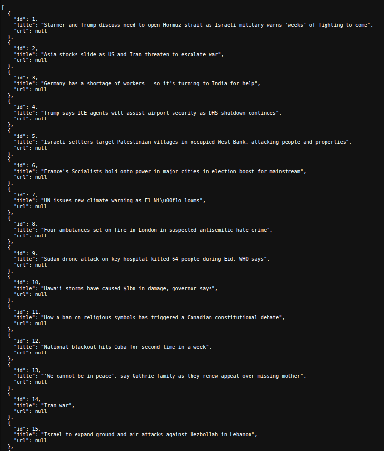

# 📰🌐 News Scraper with Web Interface
- [النسخة العربية](AR-README.md)
  
This is a Python project that scrapes headlines from a news website (e.g., BBC News) and displays them in a simple local web interface using Gradio. You can also refresh the news headlines by clicking a button.


## ✨ Features
- 🌍 Scrapes headlines from a news website.
- 🗓️⏰ Saves the headlines to a text file named with the current date and time.
- 💻🌐 Displays the headlines on a local webpage.
- 🔄 Provides a button to refresh the headlines.


## 📋 Requirements
- 🐍 Python 3.6 or higher
- 🌐 `requests` library
- 🧑‍💻 `beautifulsoup4` library
- 🖥️ `gradio` library


## 🛠 Installation

1. Open CMD 🖥️


| **Operating System** | **Steps**                                                                                                                   |
|----------------------|-----------------------------------------------------------------------------------------------------------------------------|
| **Windows** 💻        | 1. Press `Windows + R` to open the "Run" dialog box. <br> 2. Type `cmd` and hit `Enter`. <br> 3. The Command Prompt (CMD) will open. <br> Alternatively, you can search for "Command Prompt" in the Start menu and click to open it. 🔍 <br> 4. To navigate to the Desktop, type `cd %USERPROFILE%\Desktop` and hit `Enter`. 📂        |
| **Linux** 🐧          | 1. Press `Ctrl + Alt + T` to open the terminal. <br> 2. Alternatively, search for "Terminal" in your applications menu. 💨 <br> 3. To navigate to the Desktop, type `cd ~/Desktop` and hit `Enter`. 📂        |


2. Clone this repository :
```bash
git clone https://github.com/LaithALhaware/Web-Scraper-for-News-Websites.git
cd 'Web-Scraper-for-News-Websites'
```

3. Install the required dependencies :
```bash
pip install -r requirements.txt
```

4. Run the application :
```bash
python app.py
```

5. Open the local Gradio interface in your browser to view and refresh the news. 🌐🔄


## 👍 Example output from the code goes here 



## 📝 License
This project is licensed under the **License**. See the [LICENSE.txt](LICENSE.txt) ⚖️ file for details.


---
## ❤️ Support This Project
If you find this project useful, consider supporting its development:

💰 Via PayPal: [[PayPal Link](https://www.paypal.com/ncp/payment/KC9EETJDVZQHG)]

Your support helps keep this project alive! 🚀🔥
